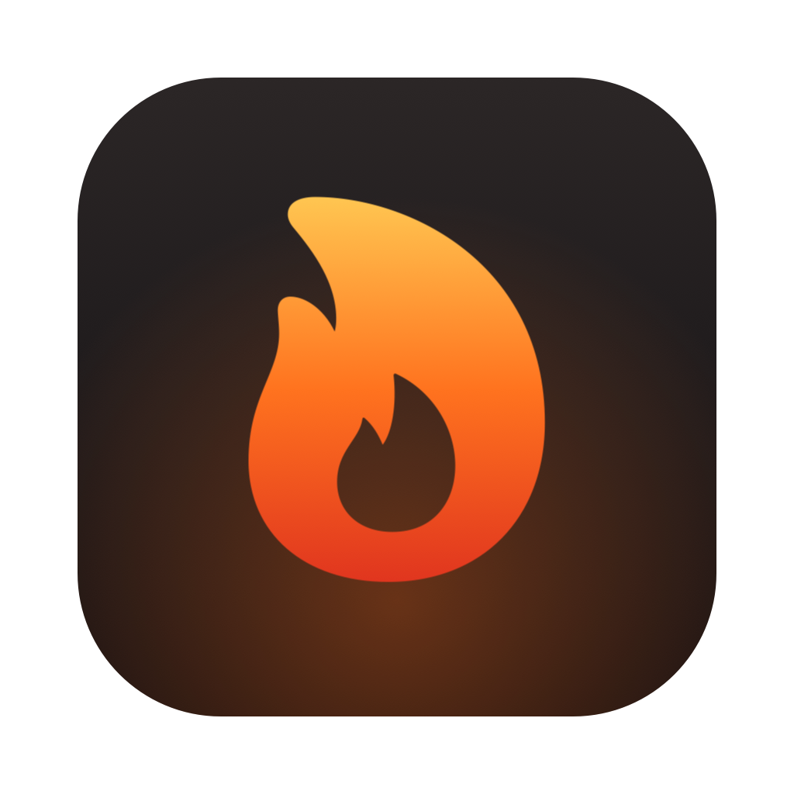
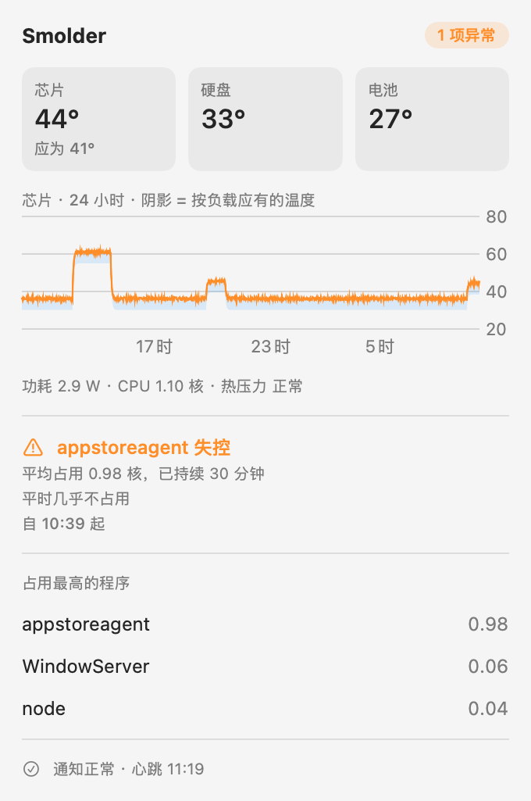

<p align="center">
  
</p>

<h1 align="center">Smolder</h1>

<p align="center"><b>没人看着的时候，也能抓住你的 Mac 在悄悄发烧。</b></p>

<p align="center"><a href="README.md">English</a></p>

---

Smolder 是一个菜单栏小软件，给那些常年开着、没人盯着看的 Mac 用：放在架子上当家庭服务器的 Mac mini、
合着盖子跑的 MacBook、编译机、24 小时跑 AI 的机器。它会学习这台 Mac 平时是什么样，真出问题时把消息推到你手机上。

它来自一次真实事故：一个系统后台进程卡在重试循环里，在一台合盖的 MacBook Air 上吃满一个 CPU 核心
**整整 8 小时**，没人发现。设温度报警也没用：那天电池温度最高只有 30.6 °C，而前一周一次正常的半小时
重活就到了 33.5 °C。**固定的温度线，要么漏报，要么狼来了。**

所以 Smolder 不问「热不热」，而是问「以它现在干的活，该不该这么热」，以及「是不是有程序在干它平时从不干的活」。

<p align="center">
  
</p>

## 盯什么

| 报警 | 什么时候响 | 为什么不用固定线 |
|---|---|---|
| **程序失控** | 某个程序的 CPU 占用远超**它自己**的常态（≥ 0.5 核，且超过它 14 天峰值的 1.5 倍），30 分钟里绝大部分时间都超线，不只是平均超线 | 天天都忙的编译器、AI 程序不会被报；平时几乎不动、突然吃满一核的后台进程会 |
| **后台一直在忙** | 屏幕全关的情况下，最近两小时里**最安静的时刻**，功耗都比平时高 1.5 W 以上 | 正常干活抬高的是功耗峰值；停不下来的东西连安静时刻也一起抬高。屏幕亮着也会抬高底线，所以有人在用 Mac 时不判断这一条 |
| **温度高于负载应有水平** | 芯片比「按当前功耗（整机和 P 核簇）应有的温度」高 3 °C 以上（或 4 倍残差 MAD），持续 20 分钟；先按最近几小时扣掉室温影响 | 学到的是功耗→温度的物理关系：重活跑得热、下午屋里热都在预料之中，风扇停转、通风口被堵才不是 |
| **硬上限** | 系统因过热降频持续 10 分钟、热压力严重，或（有电池的 Mac）电池 ≥ 35 °C | 永不学习、永不调整，兜住自适应部分可能漏掉的一切 |

每起异常只在开始时通知一次、恢复时再通知一次，不会刷屏。每条消息都写清楚测到了多少、应该是多少、
可能是谁干的。

除了逐分钟的报警，Smolder 还会一周一周地学这台 Mac 有负载时平常散热有多好。散热变好了（垫了支架、换了更凉的地方），
两周后它自己学会；变差了，它每周提醒一次，直到你回 `/accept`。慢慢变坏的故障没法一点点混成「正常」。

模型怎么工作、背后的研究依据，见 [docs/how-it-works.md](docs/how-it-works.md)（英文）。

## 哪种 Mac 都能用

只要是 Apple 芯片的 Mac 就行。Smolder 会自己识别这台机器有什么硬件，按有的来；识别结果在「设置 → 异常判断 → 这台 Mac」。

| | MacBook Air | MacBook Pro | Mac mini · Mac Studio |
|---|---|---|---|
| 芯片、硬盘温度，功耗 | ✓ | ✓ | ✓ |
| 电池温度和电池上限 | ✓ | ✓ | — |
| 用电池温度估室温（给「散热偏离参照」用） | ✓ | ✓ | —（室温升高和散热变差分不开） |
| 分开看开盖、合盖 | ✓ | ✓ | — |
| 风扇转速 | —（没有风扇） | ✓ | ✓ |

作者每天在 MacBook Air（M4）上用。Mac mini 和 Mac Studio 是新支持的，如果你在用，欢迎把 `--probe` 的输出（见下文）发过来。

## 通知方式

- **macOS 通知**：有人坐在 Mac 前时用。
- **Telegram**：报警推到你的对话里，并且机器人能回答 `/status`，告诉你实时温度、负载和占用最高的程序；
  回 `/accept` 可以把它报过「变差」的散热接受为新常态。
  「设置 → 通知 → 自动识别」会帮你找到对话 ID。
- **Webhook**：每个事件 POST 一份 JSON，也可以带上心跳。
- **自定义命令**：运行任意命令，同样的 JSON 写进它的标准输入。可以经 SSH 转给自己的服务器、接 `ntfy`、写日志。
- **失联报警**：Smolder 没法报告自己挂了。把心跳发到 healthchecks.io、Uptime Kuma 或你自己的服务器，
  让**它们**在心跳停止时报警。

在终端运行 `/Applications/Smolder.app/Contents/MacOS/Smolder --test-notify`，可以给每个通知去处各发一条测试消息。
数据格式和接法：[docs/integrations.md](docs/integrations.md)（英文）。

## 安装

需要 Apple 芯片的 Mac，macOS 14 Sonoma 或更新版本。

**Homebrew**

```bash
brew install --cask penntiao/tap/smolder
```

**直接下载**：从 [Releases](https://github.com/penntiao/smolder/releases) 下载 zip，解压后把
`Smolder.app` 拖进「应用程序」，第一次打开时右键 → 打开。

**从源码编译**（只要命令行工具，不用装 Xcode）

```bash
git clone https://github.com/penntiao/smolder.git
cd smolder
scripts/build-app.sh --install
```

> [!NOTE]
> Smolder 只做了本机签名，没有经过苹果公证（公证需要付费的苹果开发者账号）。Homebrew 安装完会去掉
> 「来自网络」的隔离标记，macOS 才会放它运行。不想信任现成的二进制，就从源码编译，一共约 3,300 行 Swift。

## 五分钟设好

1. 打开 Smolder（菜单栏出现一个小火苗），进「设置 → 通用」，勾上**登录时启动，崩溃后自动重启**。
2. **Telegram**：在 Telegram 里找 [@BotFather](https://t.me/BotFather)，发 `/newbot`，按提示建一个机器人，
   复制它给你的 token。粘贴到「设置 → 通知 → Telegram」，再给你的新机器人随便发一句话，点**自动识别**。
   之后报警就会推给你，机器人也能回答 `/status`。
3. **别让 Mac 睡着**。睡着的 Mac 没人在盯。
   - Mac mini、Mac Studio：「系统设置 → 节能」，打开**显示器关闭时，防止自动进入睡眠**。
   - 合着盖子的 MacBook：不接外接显示器的话，macOS 一合盖就让它睡觉。插着电，运行
     `sudo pmset -a disablesleep 1`（改回 `0` 即恢复），或者用 Amphetamine 这类软件。
4. 可选：设一个失联报警（「设置 → 通知 → 失联报警」），Mac 本身没声音了你也能知道。

头 72 小时 Smolder 在学这台 Mac 平时什么样，这期间只用保守的固定规则。

## 隐私与传感器

- 除非你配置了推送去处，所有数据都只留在本机。没有遥测、没有统计、不会偷偷联网检查更新。
- 不要 root、不装辅助程序、不装内核扩展。芯片温度来自 `IOHIDEventSystem` 传感器，功耗来自 SMC，
  各程序 CPU 占用来自 `/bin/ps`。这些是私有接口，以后的 macOS 可能会变；
  运行 `Smolder.app/Contents/MacOS/Smolder --probe` 可以看你的 Mac 能读到什么。
- 数据在 `~/Library/Application Support/Smolder/`：SQLite 历史（保留 90 天）、学到的模型，以及存 token 的
  `secrets.json`（权限 0600）。不放钥匙串，是因为本机签名的 App 每次更新后钥匙串都会弹窗要授权，
  而没人看着的机器前没人能点。

## 局限

- 只支持 Apple 芯片，Intel Mac 的传感器不一样。
- 没有环境温度计。Smolder 用最近几小时估出室温影响（上限 ±4 °C）再判断，下午屋里热不会被当成散热问题；代价是持续好几个小时、慢慢变坏的问题也可能被当成室温吸收掉，超出上限的高室温仍和散热变差看起来一样。每周的「散热偏离参照」用 Mac 空闲时的电池温度估室温；没有电池的 Mac（Mac mini、Mac Studio）这一项估不了。
- 「散热偏离参照」只能在有负载时判断，而且只拿同一种盖子状态（合盖或开盖）的分钟比。几乎一直空闲的 Mac 可能好几周都攒不够有负载的分钟，这期间不做这项判断。
- 风扇转速会显示、会记录，但不单独判断；风扇停转会表现为「温度高于负载应有水平」。
- 头 72 小时是学习期，这期间只用保守的固定规则。

## 参与

欢迎提 Issue 和 PR。报传感器问题时请附上 `--probe` 的输出和你的 Mac 型号。`swift test` 会跑异常判断的
场景测试（需要 Xcode；App 本身只用命令行工具就能编译）。

## 许可证

[MIT](LICENSE)
